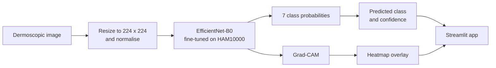
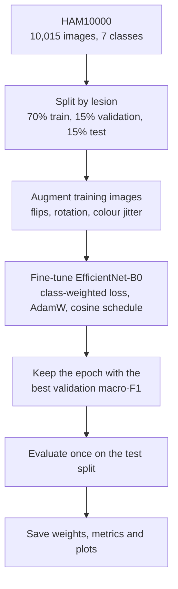

<div align="center">

# 🩺 DermaVision AI

### Explainable deep learning for skin-lesion screening from dermoscopic images

Upload a dermoscopy image and get a predicted lesion type, a confidence score, and a heatmap of *where the model looked*.


[Try it](#try-it) · [How it works](#how-it-works) · [Results](#results) · [FAQ](#faq) · [Limitations](#limitations-and-responsible-use)

</div>


### Live Deployment Link:  [](https://derma-vision-ai.streamlit.app/)


> [!WARNING]
> **Not a medical device.** DermaVision AI is a research and learning project. It cannot diagnose skin cancer, and its output must never be used to decide whether to seek medical care. If a mole or skin spot worries you, see a dermatologist.

## What is this?

Skin cancer is most treatable when it is found early. Dermatologists examine suspicious spots with a *dermatoscope*, a lighted magnifier that reveals structures the naked eye cannot see. This project explores a question: **can a neural network learn to recognise common skin-lesion types from those images, and can it show its reasoning well enough for a person to question it?**

Give the app one dermoscopic image and it returns:

- **A predicted lesion class** (one of seven) with a risk group: benign, pre-malignant or malignant.
- **A confidence score** and the full probability table, so you can see how sure or unsure the model is.
- **A Grad-CAM heatmap** showing which parts of the image pushed the model toward its answer.
- **Warnings** when the confidence is low or the image is very small.

## Try it

| I want to… | Go here |
|---|---|
| run the app on my computer | [Run it on your computer](#run-it-on-your-computer) |
| understand how it works | [How it works](#how-it-works) |
| see how well it performs | [Results](#results) |
| know what it cannot do | [Limitations and responsible use](#limitations-and-responsible-use) |


<details>
<summary><b>What you will see in the app</b></summary>

| App element | What it means |
|---|---|
| Coloured bar and risk group | Whether the predicted class is benign, pre-malignant or malignant |
| Confidence | The model's softmax score for its top class. It is **not** a calibrated probability of disease |
| Runner-up | The second most likely class and its score |
| Suspicious classes | Combined probability of melanoma, basal cell carcinoma and actinic keratosis / intraepithelial carcinoma |
| Probability table | The score for all seven classes |
| Grad-CAM panels | The input, the heatmap and an overlay. Warm colours mark regions that raised the score of the selected class |
| Low-confidence warning | Appears when the top score is below the threshold you set in the sidebar |

</details>

## How it works



1. **Preprocess.** The image is resized and normalised the same way as during training.
2. **Classify.** EfficientNet-B0, a small convolutional network pre-trained on ImageNet, was fine-tuned to separate seven lesion types.
3. **Explain.** Grad-CAM takes the network's last convolutional feature maps, weights each one by how much it raised the predicted class's score, and paints the result over the image.
4. **Present.** The Streamlit app shows the prediction, confidence, probability table and heatmap, with plain-language warnings.

<details>
<summary><b>How the model was trained</b></summary>



| Setting | Value |
|---|---|
| Backbone | EfficientNet-B0 (ImageNet weights), dropout 0.3, linear head with 7 outputs |
| Input size | 224 x 224 by default (`--img_size`) |
| Optimiser | AdamW, learning rate 3e-4, weight decay 1e-4, cosine annealing |
| Loss | Cross-entropy with label smoothing 0.05 and class weights (square-root inverse frequency) |
| Augmentation | Horizontal and vertical flips, rotation up to 30 degrees, small colour jitter |
| Model selection | Best validation macro-F1, early stopping after 6 epochs without improvement |
| Precision | Mixed precision on GPU |

</details>

## The seven classes

| Code | Lesion type | Risk group | Images in HAM10000 |
|---|---|---|---|
| `nv` | Melanocytic nevus (common mole) | Benign | 6,705 |
| `mel` | Melanoma | Malignant | 1,113 |
| `bkl` | Benign keratosis-like lesion | Benign | 1,099 |
| `bcc` | Basal cell carcinoma | Malignant | 514 |
| `akiec` | Actinic keratosis / intraepithelial carcinoma | Pre-malignant | 327 |
| `vasc` | Vascular lesion | Benign | 142 |
| `df` | Dermatofibroma | Benign | 115 |

The classes are very unbalanced: about two thirds of the images are common moles. A model that always answered "nevus" would score about 67% accuracy but only about 14% balanced accuracy. That is why this project reports balanced accuracy, macro-F1 and per-class recall instead of plain accuracy.

## Results

The model is evaluated **once**, on a held-out test split made of lesions it never saw during training or model selection.

| Training curves | Confusion matrix (test set) |
|---|---|
|  |  |

The exact numbers (accuracy, balanced accuracy, macro-F1, macro-AUC and per-class precision, recall and F1) are in [`models/metrics.json`](models/metrics.json). When you read them, look first at the recall of the three cancer-related classes (`mel`, `bcc`, `akiec`) and at how often melanoma is mistaken for a common mole.


## Project structure

```text
Derma-Vision-AI/
├── app.py                    # Streamlit app: upload, prediction, confidence, Grad-CAM
├── train.py                  # lesion-level split, training, evaluation, plots
├── dermavision.py            # shared code: classes, EfficientNet-B0 model, Grad-CAM
├── DermaVision_Colab.ipynb   # one-click Colab notebook for training
├── requirements.txt
├── .streamlit/config.toml    # theme and server settings
└── models/
    ├── dermavision_best.pt   # trained weights (best validation macro-F1)
    ├── metrics.json          # test-set results
    ├── history.json          # per-epoch loss and F1
    ├── training_curves.png
    ├── confusion_matrix.png
    └── samples/              # a few held-out test images for the demo
```

## Design decisions

<details>
<summary><b>Why the project is built this way</b></summary>

- **Split by lesion, not by image.** HAM10000 contains several photos of many lesions. Splitting by image would put near-duplicates in both training and test sets and inflate the score. Here every lesion lives in exactly one split (stratified by class), so the test score reflects lesions the model has never seen.
- **Handle imbalance on purpose.** Class-weighted loss, augmentation, and choosing the best epoch by validation macro-F1 rather than accuracy.
- **Transfer learning.** About ten thousand images is small for training from scratch, so the network starts from ImageNet weights. EfficientNet-B0 is also light enough to run on a CPU inside the web app.
- **Metrics that match the problem.** Balanced accuracy, macro-F1, macro-AUC and per-class recall, plus the confusion matrix, because the cost of missing a melanoma is not the cost of mislabelling a mole.
- **Honest explanations.** Grad-CAM is shown as "where the model looked", not as proof that its reasoning is right.
- **Safety by default.** The app always shows the disclaimer, warns on low confidence, and adds a "cannot rule out skin cancer" note even to benign predictions.

</details>

## Limitations and responsible use

- **One dataset.** The model learned from HAM10000 only. HAM10000 was collected mostly at two sites (Austria and Australia) and probably under-represents darker skin tones, so performance on other populations, cameras and clinics is unknown.
- **Dermoscopy only.** Ordinary phone photos look very different and give unreliable results.
- **Confidence is not probability.** The score is a softmax output, not a calibrated chance of disease.
- **Heatmaps can mislead.** Grad-CAM can highlight artefacts such as rulers, ink marks or image borders. It shows correlation, not causation.
- **No clinical validation.** There has been no prospective or clinical evaluation of any kind.
- **Do not use it for real decisions.** Use it to learn, to teach, and to build better research.

## Privacy and security

- Images you upload are processed in memory and are not saved or logged by this code. Even so, **do not upload images of real patients or identifiable people to a public demo**.
- The page loads two fonts from Google Fonts, so a visitor's browser contacts Google. Delete the `@import` line near the top of `app.py` if you want zero third-party requests.
- Model weights are loaded with `torch.load(..., weights_only=True)`. Never load `.pt` files from untrusted sources without that option.
- No keys or secrets belong in this repository. If you use a Kaggle API token in Colab, store it as a Colab secret, never in code.
- Found a problem? Please open an [issue](https://github.com/al-shovon/Derma-Vision-AI/issues) without posting sensitive details.

## FAQ

<details>
<summary><b>Can it tell me whether my mole is cancer?</b></summary>

No. It is a learning project trained on a single dataset and has never been clinically validated. Only a doctor can assess a skin lesion. If something looks new, changing, bleeding or different from your other moles, book a dermatology appointment.

</details>

<details>
<summary><b>Why did my phone photo get a low-confidence warning?</b></summary>

The model has only ever seen dermoscopic images, taken with a dermatoscope. Ordinary photos look very different, so its answers on them are unreliable. The warning is there on purpose.

</details>

<details>
<summary><b>What do the heatmap colours mean?</b></summary>

Warm colours (red, yellow) mark regions that raised the score of the selected class; cool colours (blue) had little influence. Use it as a visual sanity check. If the model is "looking" at a ruler or a border instead of the lesion, treat the prediction with suspicion.

</details>

<details>
<summary><b>How accurate is it?</b></summary>

See [Results](#results) and `models/metrics.json`. Because two thirds of the images are common moles, read balanced accuracy and per-class recall rather than accuracy alone.

</details>

<details>
<summary><b>Can I use it commercially?</b></summary>

The code is MIT-licensed, but the HAM10000 dataset is CC BY-NC 4.0, which allows non-commercial use only. Treat the trained weights and the sample images as derived from that data and use them for non-commercial research and learning.

</details>

<details>
<summary><b>Can I train it on my own dataset?</b></summary>

`train.py` expects HAM10000's layout: a metadata file with `lesion_id`, `image_id` and `dx` columns plus the image files. For another dataset, adapt `load_metadata` and the class list in `dermavision.py`, and keep the split grouped by lesion or patient.

</details>

## Roadmap

- [x] Lesion-level data split with no leakage
- [x] EfficientNet-B0 transfer learning with class-weighted loss
- [x] Grad-CAM explanations
- [x] Streamlit app with safety messaging
- [x] One-click Colab training notebook
- [ ] Public live demo
- [ ] Calibrated confidence (temperature scaling)
- [ ] Ablations: image size, larger backbones, test-time augmentation
- [ ] Evaluation on external data and across skin tones

## Acknowledgements and citations

- **Dataset:** HAM10000, by Tschandl, Rosendahl and Kittler. Available on [Kaggle](https://www.kaggle.com/datasets/kmader/skin-cancer-mnist-ham10000) and on the [Harvard Dataverse](https://doi.org/10.7910/DVN/DBW86T). Licence: CC BY-NC 4.0, so credit the authors and use it non-commercially.
- **EfficientNet:** Tan and Le, [*EfficientNet: Rethinking Model Scaling for Convolutional Neural Networks*](https://arxiv.org/abs/1905.11946), ICML 2019.
- **Grad-CAM:** Selvaraju et al., [*Grad-CAM: Visual Explanations from Deep Networks via Gradient-Based Localization*](https://arxiv.org/abs/1610.02391), ICCV 2017.
- Built with PyTorch, torchvision, scikit-learn, Matplotlib and Streamlit, and trained on Google Colab.

<details>
<summary><b>BibTeX for the dataset</b></summary>

```bibtex
@article{tschandl2018ham10000,
  title   = {The {HAM10000} dataset, a large collection of multi-source dermatoscopic images of common pigmented skin lesions},
  author  = {Tschandl, Philipp and Rosendahl, Cliff and Kittler, Harald},
  journal = {Scientific Data},
  volume  = {5},
  pages   = {180161},
  year    = {2018},
  doi     = {10.1038/sdata.2018.161}
}
```

</details>

## License

The code is released under the [MIT License](LICENSE). The HAM10000 data, and anything derived from it (including the trained weights and sample images in `models/`), stays under [CC BY-NC 4.0](https://creativecommons.org/licenses/by-nc/4.0/).

Maintained by [@al-shovon](https://github.com/al-shovon). Suggestions and issues are welcome. If this project helped you learn something, a ⭐ is always appreciated.
